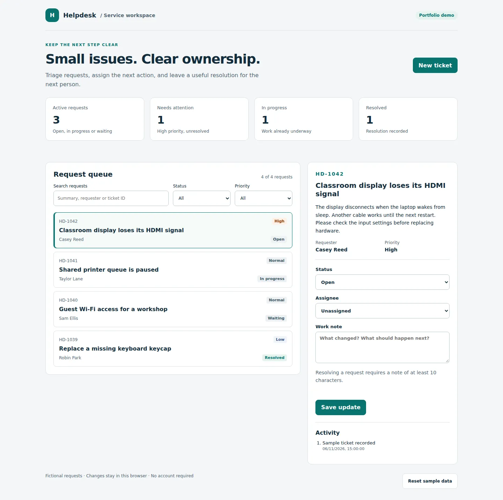

# Helpdesk — requests with a clear next step

A support queue for small teams: capture the problem, assign ownership, and record how it was resolved.

**Portfolio project by Only Sahifli Supit · JavaScript · HTML/CSS · Node.js tests**

This standalone demo uses fictional requests. It is designed for a reviewer to explore without an account, a database, or API keys. It demonstrates a workflow; it is not connected to a school or client system.



[View the mobile layout](docs/mobile.webp)

## Try the workflow in two minutes

```bash
git clone https://github.com/onlysahiflisupit/it-helpdesk-demo.git
cd it-helpdesk-demo
npm start
```

Requires Node.js 22 or later. Open **http://127.0.0.1:4173**. No dependency installation or build step is needed.

1. Open the high-priority display issue and review the description.
2. Assign it to Alex Morgan and move it to **In progress**.
3. Try resolving it with only “Done”. The application requests a more useful note.
4. Add a specific resolution, save, then reload the page. The ticket and history remain.
5. Search by requester, combine status and priority filters, or reset the sample data.

## What the code demonstrates

| Workflow decision | Implementation | Why it matters |
|---|---|---|
| A resolution needs context | A note of at least 10 characters is required | The next technician can see what was done |
| Work has an owner | Status, assignee and notes appear in activity history | A request has a visible next step |
| Empty search results explain recovery | Search and filters combine; no-match text suggests changing them | Users do not mistake an empty view for data loss |
| Input is treated as text | User-entered content is escaped before rendering | Markup in a ticket does not become executable HTML |
| Persistence can fail | Corrupt or unavailable browser storage produces a visible message | The interface does not silently claim a save succeeded |

## Review the implementation

- [Business rules and design choices](docs/design.md)
- [Automated domain tests](tests/domain.test.mjs)
- [Testing scope](TESTPLAN.md) and [known limitations](RISK.md)
- [Support runbook: printer queue](docs/printer-troubleshooting.md)
- [Sample customer update](docs/customer-update.md)
- [Browser regression portfolio](https://github.com/onlysahiflisupit/qa-testing-portfolio)

```bash
npm test
```

The interface is intentionally built with native browser modules. This keeps the example easy to inspect and separates the business rules from the DOM. It does not claim to demonstrate React or a backend implementation.

## Scope before real-world use

Data lives in localStorage on one browser. There is no authentication, role enforcement, email delivery, shared database, or secure audit log. Production use would need those capabilities, server-side validation and a recovery strategy. The included server is for local demonstration only.

[About Only](https://github.com/onlysahiflisupit) · [Course reporting demo](https://github.com/onlysahiflisupit/course-management-demo)
